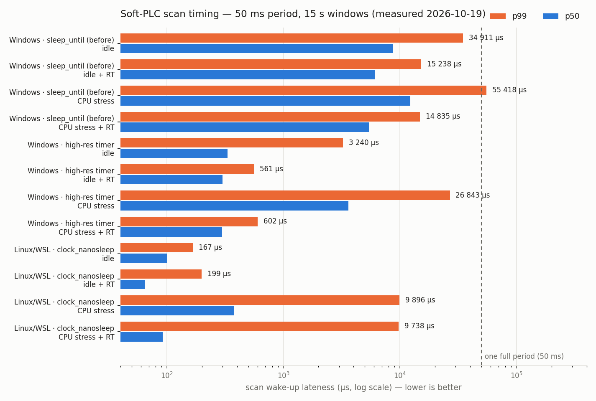
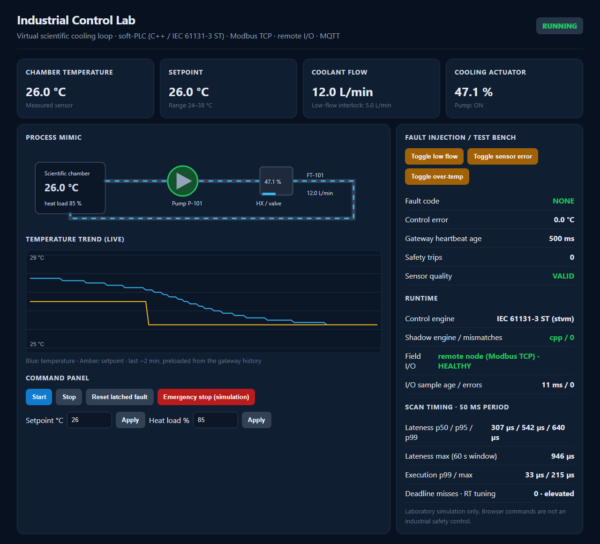
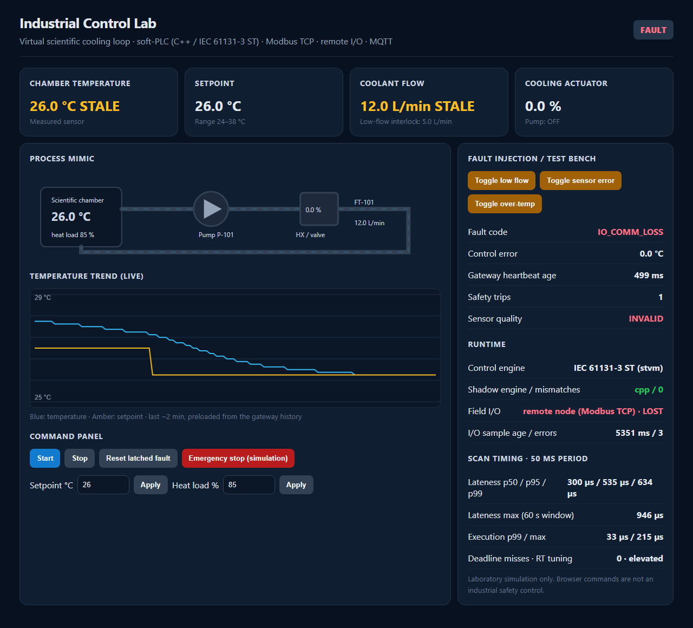

# 🏭 Industrial Control Lab — Soft-PLC em C++ e IEC 61131-3 ST, do I/O Remoto Modbus TCP à Telemetria MQTT

### C++17 · IEC 61131-3 Structured Text · Python 3 · PlatformIO (native) · Modbus TCP · MQTT (Mosquitto) · Prometheus · Docker Compose · GitHub Actions

[](https://github.com/Yuri-Fernando/Industrial-Control-Lab/actions/workflows/ci.yml)


-c8742a)


## Status

🟡 **MVP técnico funcional — v0.2.0** — o controlador soft-PLC roda com motor em **C++** ou em **Structured Text**,
fecha a malha através de um **nó de I/O remoto** em outro processo/container e publica telemetria por REST,
Prometheus e MQTT. Validado em Windows 11, Linux (WSL Ubuntu 24.04), Docker e no CI do GitHub (Linux + Windows): 28 testes Unity, 22 testes de
integração com processos e sockets reais, 6/6 cenários de aceitação e captura MQTT real. Ainda não verificado:
o mesmo `.st` num runtime IEC externo (OpenPLC/matiec) e kernel PREEMPT_RT.

| Frente | Estado | Evidência |
|---|---|---|
| Controle em C++17 | ✅ testado | `test/test_native` (10), `IntegrationTest` (12) |
| Structured Text executado no ciclo de scan | ✅ testado | `test/test_stvm` (10), `StEngineIntegrationTest` (4) |
| I/O distribuído (processo/container separado) | ✅ testado | `RemoteIoIntegrationTest` (6), `test/test_modbus` (8) |
| Telemetria IIoT (REST · Prometheus · MQTT) | ✅ testado | `test_06c_rest_http`, [captura MQTT](docs/evidence/mqtt_capture_docker_2026-10-19.txt) |
| Caracterização de tempo real | ✅ medido | [gráfico](docs/img/scan_timing.png), [JSONs](docs/evidence/) |
| Runtime IEC externo (OpenPLC/matiec) | ⏳ planejado | [PLC_ST_GUIDE](docs/PLC_ST_GUIDE.md) |

---

## Descrição / Contexto

**Laboratório de software de automação e controle sem hardware.**

Um circuito virtual de refrigeração de infraestrutura científica — bomba, vazão, temperatura, válvula de
resfriamento e carga térmica — controlado por um **soft-PLC** com ciclo de scan de 50 ms. O foco não é o painel:
é o que um sistema de controle precisa resolver de verdade antes de encostar em equipamento — arquitetura,
intertravamentos com trava (*latch*), Structured Text, I/O distribuído e suas falhas, protocolo industrial,
telemetria, tempo de ciclo medido e rastreabilidade de requisitos.

Tudo roda num notebook: o controlador e o nó de I/O são executáveis C++ compilados pelo PlatformIO (`native`), o
gateway é Python sem dependências obrigatórias e a stack completa sobe também em Docker Compose. Nenhum número
deste README é estimado: todos saem de testes e benchmarks executados neste repositório.

> **Sobre o nome:** *Industrial Control Lab* — um laboratório (bancada de ensaio) para software de controle
> industrial: a planta é simulada, mas as interfaces, os protocolos e os modos de falha são os reais.

---

## 🧭 Origem do Projeto

O projeto nasceu de uma pergunta prática: **como desenvolver e validar software de controle para uma
infraestrutura científica quando não há hardware disponível?** Antes de escrever código, foram cruzados os
temas que um sistema desses toca — a norma IEC 61131-3, o protocolo Modbus TCP, a plataforma `native` do
PlatformIO, padrões de telemetria MQTT e o comportamento de *scheduling* de sistemas operacionais de uso geral.
Daí saíram as conclusões que definiram o projeto:

1. **A planta pode ser virtual; as fronteiras não.** Controle, I/O e supervisão ficam em processos separados que
   conversam por protocolos reais, para que os modos de falha (link caído, dado velho, latência) existam de verdade;
2. **ST e C++ têm de ser a mesma lógica, provadamente.** Em vez de manter um `.st` "de referência", o ST precisa
   rodar no ciclo de scan e ser comparado passo a passo com o C++;
3. **Tempo real se mede, não se declara.** O ciclo publica percentis de atraso e de execução; nenhuma afirmação de
   *hard real-time* é feita;
4. **Segurança é simulada e dita como tal.** O ESTOP é um comando de software; travas, permissivos de reset e
   estados seguros são testados, mas nada substitui uma cadeia de segurança física.

A **v0.1** (2026-10-17) foi um pacote inicial: controlador C++ para Linux, servidor Modbus, gateway Python e um
`.st` apenas de referência. A **v0.2** (2026-10-19) partiu de uma revisão desse pacote no ambiente real de
desenvolvimento (VS Code + PlatformIO no Windows) e fechou as lacunas como **módulos aditivos**, sem alterar
nenhum offset do contrato Modbus. Cada etapa só avançou com um **gate de evidência**: build no Windows e no
Linux → testes Unity → integração com processos reais → aceitação REST → Docker + MQTT → benchmark de tempo.
O desenvolvimento foi conduzido com agentes de IA (Claude Code) sob essas regras: nenhuma etapa avança sem
prova e nenhuma capacidade é declarada sem teste.

---

## 🎯 Objetivo

- Executar a lógica de intertravamento tanto em **C++** quanto em **IEC 61131-3 ST**, com equivalência provada
  por teste diferencial e por um motor "sombra" ao vivo;
- Fechar a malha através de uma **fronteira real de processo/rede** (nó de I/O remoto via Modbus TCP);
- Detectar e tratar falhas distribuídas: queda de link, amostra congelada, latência, controlador morto;
- **Medir** o comportamento temporal do scan (p50/p95/p99/máx.) em Windows e Linux, ocioso e sob estresse;
- Disponibilizar telemetria via REST, Prometheus e MQTT, com uma IHM web que marca dados sem validade;
- Manter requisitos rastreáveis (FR/NFR → código → teste) e build reproduzível em Windows, Linux e Docker.

---

## 🔬 Linha de Pesquisa / Desenvolvimento

- Arquitetura de controle por software (soft-PLC / vPLC): imagem de processo, scan cíclico, motores intercambiáveis;
- Linguagens IEC 61131-3: interpretador próprio de um subconjunto de ST, com precedência e tipos da norma;
- Redes industriais: Modbus TCP (servidor e cliente em C++, cliente em Python), FC03/04/06/16, exceções, *fuzzing*;
- I/O distribuído e tolerância a falhas: amostra *stale*, watchdog de saída, estado seguro (*fail-safe*);
- Tempo real *soft*: sono por prazo absoluto, timers de alta resolução, `SCHED_FIFO`, percentis de atraso;
- IIoT: gateway de borda Modbus → MQTT (QoS, retained, last-will), REST e métricas Prometheus;
- Engenharia de requisitos e verificação: SRS rastreável, teste diferencial com oráculo independente.

---

## 🏗️ Arquitetura

### Sistema

```text
 Nó de I/O remoto (io_node, 100 Hz)          Controlador soft-PLC (scan 50 ms)                 Supervisão
 ┌───────────────────────────────┐   Modbus  ┌──────────────────────────────────────┐ Modbus  ┌──────────────────┐
 │ planta térmica (bomba, vazão, │   TCP     │ thread de I/O (20 ms, stale-check)   │  TCP    │ gateway Python   │
 │ temperatura, válvula)         │◄─────────►│        ↓ imagem de processo          │◄───────►│  ├─ REST + IHM   │
 │ watchdog de saída 500 ms      │  :15021   │ motor: C++  ⇄ sombra ⇄  ST (stvm)    │ :15020  │  ├─ /metrics     │
 │ injeção: falha, congelamento, │ (fieldnet)│        ↓ PI + anti-windup            │         │  └─ MQTT ───────►│ Mosquitto
 │ latência                      │           │ timing p50/p95/p99 · watchdogs       │         └──────────────────┘ :1883
 └───────────────────────────────┘           └──────────────────────────────────────┘
```

Diagrama Mermaid, ADR-001…011 e tabela completa de modos de falha: [docs/ARCHITECTURE.md](docs/ARCHITECTURE.md).

### Ciclo de scan (um período de 50 ms)

```text
sleep_until_precise(prazo absoluto)
   ↓
varredura de entradas: fila de comandos · heartbeat · última amostra de campo (stale → inválida)
   ↓
lógica: motor primário (C++ ou ST) + motor sombra com as mesmas entradas → contador de divergências
   ↓
varredura de saídas: bomba · válvula · carga · injeções → IoChannel (local ou thread de I/O remota)
   ↓
diagnóstico: atraso e tempo de execução → janelas de 60 s → registradores Modbus
```

### Módulos

| Módulo | Função | Teste |
|---|---|---|
| `lib/control` | máquina de estados (STOPPED/STARTING/RUNNING/FAULT/ESTOP), `PiCooling`, planta | `test_native` |
| `lib/stvm` | interpretador de ST (subconjunto IEC 61131-3) + `StController` | `test_stvm` (inclui diferencial) |
| `lib/io` | `IoChannel` (local/remoto), `RemoteIo` com thread de I/O, `IoNodeDevice` | `test_modbus`, `RemoteIoIntegrationTest` |
| `lib/modbus` | `ModbusDevice`, tratador de quadros, servidor com cota de sessões, cliente persistente | `test_modbus` (*fuzz*), integração |
| `lib/net` | sockets portáveis (POSIX / Winsock2) | build Windows + Linux |
| `lib/timing` | percentis em janela deslizante, ajuste RT, `sleep_until_precise` | `test_sliding_percentiles`, `lab.py bench` |
| `src/main.cpp` | processo controlador (scan, registradores) | integração |
| `src/io_node/main.cpp` | processo do nó de I/O remoto | integração |
| `st/FB_Interlocks.st` | intertravamentos em ST portável | `test_stvm`, `StEngineIntegrationTest` |
| `gateway/` | cliente Modbus, REST, IHM, histórico, MQTT, Prometheus | integração |

---

## ⚙️ Funcionamento

1. O gateway escreve um *heartbeat* a cada 500 ms; sem ele por 3 s o controlador trava em `WATCHDOG`;
2. Cada scan dorme até o prazo absoluto, lê a fila de comandos e a última amostra de campo;
3. O motor selecionado (`CONTROL_ENGINE=cpp|st`) executa; o outro roda em sombra com as mesmas entradas, e
   qualquer divergência incrementa o registrador `ENGINE_MISMATCHES`;
4. START energiza a bomba (STARTING); com vazão ≥ 5 L/min passa a RUNNING e o PI calcula o resfriamento; sem vazão
   em 2 s, trava em `LOW_FLOW`;
5. Sensor inválido, temperatura ≥ 45 °C, vazão baixa, perda do I/O ou ESTOP desligam as saídas e **travam**:
   STOP não limpa a falha, e RESET só funciona com a causa removida;
6. No modo remoto, a thread de I/O escreve as saídas (com contador de watchdog) e lê as entradas do nó a cada
   20 ms; se a sequência de amostras não muda por 300 ms, o dado é *stale* → `IO_COMM_LOSS`;
7. O gateway decodifica os registradores e publica REST, Prometheus e MQTT; a IHM mostra valores de I/O sem
   saúde como `STALE`, nunca como medição atual.

```text
operador → IHM/REST → gateway → Modbus :15020 → scan (motor C++/ST) → thread de I/O → Modbus :15021 → planta
planta → amostra (seq) → thread de I/O → scan → registradores → gateway → REST / Prometheus / MQTT
```

---

## 🧠 Verificação / Modelagem

| Camada | O que prova | Resultado |
|---|---|---|
| Unity `test_native` | estados, travas, timeout de partida, anti-windup, malha fechada atinge o setpoint | 10/10 |
| Unity `test_stvm` | precedência IEC, CASE, tipos (INT 16 bits, REAL float32), erros de compilação com linha, ST × C++ passo a passo | 10/10 |
| Unity `test_modbus` | exceções Modbus, FC16 atômico, FIFO limitado, 20 000 quadros aleatórios, *fail-safe* do nó de I/O, percentis | 8/8 |
| Integração `IntegrationTest` | processo C++ real + gateway via TCP: falhas, travas, REST, histórico, diagnósticos de tempo | 12/12 |
| Integração `StEngineIntegrationTest` | o ST controla o processo real; trava, ESTOP, timeout; 0 divergências com a sombra C++ | 4/4 |
| Integração `RemoteIoIntegrationTest` | queda do nó, amostra congelada, latência 60 ms tolerada / 500 ms dispara, injeção no nó, controlador morto → *fail-safe* | 6/6 |
| Aceitação REST (`lab.py demo`) | 6 cenários de operação ponta a ponta | 6/6 (nativo remoto + ST e Docker) |

**Oráculo independente.** O motor C++ (`icl::Controller`) e o arquivo ST são escritos separadamente. O teste
diferencial gera 8 sementes × 25 000 scans com comandos, temperaturas (incluindo exatamente 45,0 °C), vazões,
falhas e `dt` aleatórios, compara estado, falha, bomba, contador de trips e saída do PI a cada scan, e exige que
os 5 estados e os 7 códigos de falha sejam alcançados — um teste que não visita todos os estados não passa.
Em execução, o motor não selecionado roda em sombra e qualquer divergência aparece no registrador 26.

---

## 🧪 Desenvolvimento Experimental

```text
Revisão da v0.1 no ambiente real (Windows + PlatformIO)
   ↓
Camada de rede portável → build PlatformIO no Windows e GCC no Linux
   ↓
Testes Unity + integração com processos reais (Windows e WSL)
   ↓
ST executado no scan + teste diferencial contra o C++
   ↓
Nó de I/O remoto + falhas distribuídas (queda, congelamento, latência, watchdog)
   ↓
Benchmark de tempo (ocioso/estresse × RT) → correção do timer → nova medição
   ↓
Docker Compose (4 serviços, rede de campo isolada) + captura MQTT
```

**Achados reais durante o desenvolvimento (não plantados):**

1. **O projeto não compilava no PlatformIO do Windows** — o código usava `netinet/in.h` (POSIX) e um
   `std::clamp(long long, 0L, 65535L)` que só compila onde `long` tem 64 bits. Uma camada fina `lib/net` isolou
   POSIX e Winsock2, e um *hook* do PlatformIO linka `ws2_32`/`winmm` e o runtime C++ estático
   ([ADR-007](docs/ARCHITECTURE.md));
2. **O STOP limpava uma falha travada no ST** — a condição `StopRequest AND State <> 4` da v0.1 deixava STOP sair
   de FAULT, o oposto do invariante de trava do projeto. Achado na revisão do `.st`; corrigido para
   `State ∈ {STOPPED, STARTING, RUNNING}` e agora travado pelo teste diferencial;
3. **O teste diferencial pegou uma divergência no passo 319** — estado, falha e bomba batiam, mas `cooling_pct`
   não: o adaptador do ST passava ao PI o `dt` sem saturar, enquanto o C++ satura em 0,2 s. Uma linha de
   correção ([ADR-009](docs/ARCHITECTURE.md));
4. **8 ms de atraso mediano por scan no Windows** — o benchmark mostrou p50 de 8,7 ms e p99 de 55 ms sob estresse
   com `std::this_thread::sleep_until`. Pedir `timeBeginPeriod(1)` não resolveu (p50 ainda ~6 ms): no Windows 11
   a resolução não é garantida para processos sem janela visível. A troca por um *waitable timer* de alta
   resolução com prazo absoluto (e `clock_nanosleep(TIMER_ABSTIME)` no Linux) levou o p99 sob estresse a
   **0,6 ms** com ajuste RT ([ADR-011](docs/ARCHITECTURE.md));
5. **A imagem Docker da v0.1 nunca teria iniciado** — o `gcc:14` gera binários que exigem `GLIBCXX_3.4.32`,
   ausente no `debian:bookworm-slim`. Resolvido com `-static-libstdc++ -static-libgcc` na imagem;
6. **Os testes de integração subiam o binário errado** — o `pio test` grava o executor Unity em
   `.pio/build/native/program.exe`, o mesmo caminho do controlador. Os testes unitários ganharam um env
   PlatformIO próprio (`test`);
7. **"Acesso negado" no build e processos órfãos** — quando o `setUpClass` de uma suíte falhava, o `unittest` não
   chamava o `tearDownClass` e os nós de I/O ficavam rodando, travando o `.exe` para o próximo build. A fixture
   passou a usar `addClassCleanup`, e o `lab.py` coloca a stack num *Job Object* (Windows) /
   `PR_SET_PDEATHSIG` (Linux) para que nada sobreviva ao lançador. Como o checkout vive numa pasta sincronizada
   (Google Drive), o build também foi movido para disco local via `platformio_local.ini`;
8. **A IHM mostrava dado velho como se fosse atual** — o print da tela em `IO_COMM_LOSS` mostrou 12,0 L/min e o
   fluxo animado com a bomba desligada: eram os últimos valores do nó caído. Valores de I/O sem saúde agora
   aparecem como `STALE` e o sinótico para;
9. **Ambiente** — o Docker Desktop não monta arquivos de uma unidade do Google Drive; a configuração do
   Mosquitto passou a ser *inline* na Compose (`configs.content`).

---

## 🛠️ Tecnologias

**Linguagens:** C++17 · IEC 61131-3 Structured Text · Python 3.10+ · HTML/CSS/JS

**Controle e runtime:** STL (`<thread>`, `<chrono>`, `<mutex>`) · interpretador ST próprio (`stvm`) · timers de alta resolução (Win32 / `clock_nanosleep`)

**Protocolos:** Modbus TCP (FC03/04/06/16) · MQTT 3.1.1 (`paho-mqtt`, opcional) · HTTP/REST · formato de exposição Prometheus

**Testes:** Unity (via PlatformIO) · `unittest` com processos e sockets reais · teste diferencial · *fuzzing* de quadros

**Infra:** PlatformIO `native` · MinGW-w64 GCC (Windows) · GCC (Linux/WSL) · Docker Compose · Eclipse Mosquitto · GitHub Actions (Linux + Windows)

**Análise:** `scripts/lab.py bench` · `scripts/plot_timing.py` (matplotlib) · relatórios JSON em `docs/evidence/`

---

## 📊 Resultados

### Tempo de scan

Período de 50 ms; janelas de 15 s; *atraso* = quanto o scan acordou depois do prazo. Medido com
`python scripts/lab.py bench --seconds 15` em 2026-10-19 (valores em µs).

<p align="center">
  <a href="docs/img/scan_timing.png"></a>
  <br><sub>p50 e p99 do atraso do scan por condição (escala log). Gerado por <code>scripts/plot_timing.py</code> a partir de <code>docs/evidence/</code>.</sub>
</p>

| Host | Temporizador | Condição | p50 | p95 | p99 | máx. | exec. p99 | deadlines perdidos |
|---|---|---|---|---|---|---|---|---|
| Windows 11, 6 CPUs | `sleep_until` (antes) | ocioso | 8 691 | 18 351 | 34 911 | ≥ 65 535 | 1 531 | 2 |
| Windows 11 | `sleep_until` (antes) | estresse | 12 249 | 23 522 | 55 418 | ≥ 65 535 | 912 | 6 |
| Windows 11 | alta resolução | ocioso | 331 | 1 878 | 3 240 | 19 003 | 538 | 0 |
| Windows 11 | alta resolução | ocioso + RT | 301 | 513 | 561 | 595 | 21 | 0 |
| Windows 11 | alta resolução | estresse | 3 603 | 13 592 | 26 843 | 32 084 | 1 822 | 0 |
| Windows 11 | alta resolução | estresse + RT | 298 | 526 | 602 | 698 | 23 | 0 |
| WSL Ubuntu 24.04, 4 CPUs | `clock_nanosleep` | ocioso | 100 | 120 | 167 | 334 | 15 | 0 |
| WSL Ubuntu 24.04 | `clock_nanosleep` | estresse + RT pedido* | 92 | 7 565 | 9 738 | 10 183 | 357 | 0 |

\* sem `CAP_SYS_NICE` o `SCHED_FIFO` é recusado; o controlador reporta isso (registrador 25 = 0) em vez de
esconder. "Estresse" = um processo de CPU ocupada por núcleo. O registrador de máximo satura em 65 535 µs.
São medições num sistema operacional de uso geral: **não** são garantia de tempo real rígido.

### Equivalência ST × C++

200 000 scans aleatórios + 6 000 scans em malha fechada com a planta: **0 divergências**
(`test_differential_*`). Ao vivo, `ENGINE_MISMATCHES = 0` ao final das campanhas de aceitação
([evidência](docs/evidence/acceptance_remote_st_2026-10-19.json)).

### I/O distribuído

| Falha injetada | Reação esperada | Resultado |
|---|---|---|
| nó de I/O encerrado | `IO_COMM_LOSS` travado, bomba desligada, RESET recusado até o nó voltar | ✅ (orçamento de *stale*: 300 ms) |
| amostra congelada com link ativo | `IO_COMM_LOSS` | ✅ |
| latência de 60 ms por resposta | tolerada, segue RUNNING | ✅ |
| latência de 500 ms por resposta | `IO_COMM_LOSS` | ✅ |
| controlador encerrado | nó força saídas OFF (`FAILSAFE_ACTIVE`) | ✅ (watchdog: 500 ms) |

---

## 🖼️ Evidências

> As imagens são clicáveis e abrem em tamanho real.

### 🖥️ IHM — operação normal

<p align="center">
  <a href="docs/img/hmi_running.png"></a>
  <br><sub>Motor ST controlando, C++ em sombra (0 divergências), I/O remoto saudável, setpoint alterado de 27 para 26 °C e carga de 60 para 85 %. Captura real da stack em execução.</sub>
</p>

### ⚠️ IHM — nó de I/O caído

<p align="center">
  <a href="docs/img/hmi_io_comm_loss.png"></a>
  <br><sub>O processo do nó de I/O foi encerrado: <code>IO_COMM_LOSS</code> travado, bomba desligada, valores de campo marcados como <code>STALE</code>.</sub>
</p>

### 📄 Arquivos de evidência

- [Relatório de validação](docs/VALIDATION_REPORT.md) — o que foi observado, em qual host e data;
- Tempo de scan: [Windows antes](docs/evidence/timing_windows_before_adr011_2026-10-19.json) ·
  [Windows depois](docs/evidence/timing_windows_2026-10-19.json) · [Linux/WSL](docs/evidence/timing_linux_wsl_2026-10-19.json);
- Aceitação: [I/O remoto + motor ST](docs/evidence/acceptance_remote_st_2026-10-19.json) ·
  [Docker](docs/evidence/acceptance_docker_2026-10-19.json);
- [Captura MQTT (`mosquitto_sub`) da stack Docker](docs/evidence/mqtt_capture_docker_2026-10-19.txt).

---

## 🚀 Aplicações

- Bancada de ensaio de lógica de intertravamento antes do comissionamento de hardware;
- Ambiente para estudar e testar estratégias de tratamento de falhas de rede de campo;
- Base para comparar runtimes de controle (C++, ST, futuramente OpenPLC) com a mesma bateria de testes;
- Material didático de arquitetura de automação: scan cíclico, imagem de processo, Modbus, IIoT e tempo real;
- Ponto de partida para *hardware-in-the-loop*: um ESP32 implementando o mesmo contrato do nó de I/O.

---

## 🔭 Visão de Longo Prazo

```text
v0.2 — soft-PLC C++/ST + I/O remoto virtual + IIoT (atual)
   ↓
mesmo ST em OpenPLC/matiec + matriz diferencial idêntica
   ↓
PREEMPT_RT + isolamento de CPU + falhas de rede com tc netem
   ↓
nó de I/O em ESP32 (mesmo contrato Modbus) — hardware-in-the-loop
   ↓
OPC UA + segurança OT (autenticação, TLS, ACL, auditoria)
```

---

## 🗺️ Roadmap

- **F0 — Baseline reproduzível** ✅ Concluída — build e testes em Windows, Linux e Docker ([relatório](docs/VALIDATION_REPORT.md));
- **F1 — Capacidades centrais** 🟡 Parcial — ST executado + diferencial, I/O remoto, timing ✅; runtime IEC externo e segurança OT ⏳;
- **F2 — Experimentação** ⏳ Planejada — PREEMPT_RT, `tc netem`, identificação de modelo, OPC UA;
- **F3 — Hardware-in-the-loop** ⏳ Planejada — nó de I/O em ESP32/STM32 com cadeia de segurança independente.

Detalhes: [docs/ROADMAP.md](docs/ROADMAP.md).

---

## 🕓 Histórico e Mudanças

| Versão | Data | O que mudou |
|---|---|---|
| v0.1.0 | 2026-10-17 | controlador C++ Linux, Modbus TCP, gateway REST/MQTT, ST de referência, 11 testes de integração |
| v0.2.0 | 2026-10-19 | build Windows/Linux, ST executado (stvm) + diferencial, I/O remoto, timing, Docker/MQTT validados, IHM com sinótico e qualidade de dado, 50 testes |

Detalhes em [CHANGELOG.md](CHANGELOG.md).

---

## 🔮 Próximos Passos

**Concluídos nesta versão ✅** — build no PlatformIO do Windows, ST no ciclo de scan com prova de equivalência, I/O
distribuído com falhas reais, benchmark de tempo, Docker + MQTT, IHM com qualidade de dado.

**Dependem de ambiente** — Linux com `sudo` para compilar o matiec e medir `SCHED_FIFO` com privilégio; kernel
PREEMPT_RT para a próxima rodada de medições.

**Próximos técnicos (o que eu faria numa v0.3)** — rodar o `FB_Interlocks.st` no OpenPLC contra o nó de I/O e
repetir a matriz diferencial; autenticação de comandos e ACL no broker; interoperabilidade com `libmodbus`;
`tc netem` na rede `fieldnet` para perda de pacotes e *jitter*.

---

## ▶️ Como rodar localmente

**Pré-requisitos:** Python 3.10+ e um GCC do host. No Windows, PlatformIO IDE (extensão do VS Code) + MinGW-w64
no PATH (ex.: MSYS2 UCRT64); no Linux/WSL, `build-essential`. O PlatformIO **não** instala o compilador do host.

```bash
git clone https://github.com/Yuri-Fernando/Industrial-Control-Lab.git
cd Industrial-Control-Lab

# 1) compilar controlador + nó de I/O (usa PlatformIO; sem ele, cai para g++)
python scripts/lab.py build

# 2) subir a stack e abrir a IHM em http://127.0.0.1:8088
python scripts/lab.py run                                  # I/O local, motor C++
python scripts/lab.py run --io remote --engine st --rt     # I/O remoto + Structured Text + ajuste RT

# 3) com a stack rodando, em outro terminal: campanha de aceitação
python scripts/lab.py demo

# 4) todos os gates (build PlatformIO + Unity + integração com sockets reais)
python scripts/lab.py test

# 5) caracterização do tempo de scan e gráfico
python scripts/lab.py bench --seconds 15
python scripts/plot_timing.py
```

| Ambiente | Comandos | Verificado nesta revisão |
|---|---|---|
| Windows 11 + VS Code + PlatformIO | `pio run`, `pio test -e test`, tarefas `ICL: …` em `.vscode/tasks.json`, `python scripts/lab.py …` | ✅ |
| Linux / WSL | `./scripts/build_native.sh`, `./scripts/run_local.sh --io remote`, `./scripts/quality_gate.sh` | ✅ (build GCC + integração + bench) |
| Docker | `docker compose up --build -d` → IHM em `:8088`; `docker compose exec mosquitto mosquitto_sub -t 'icl/thermal/#' -v` | ✅ |
| GitHub Actions | `.github/workflows/ci.yml` (ubuntu-24.04 + windows-latest) | ✅ 28 Unity + 22 integração nos dois runners |

**Projeto em pasta sincronizada (Google Drive/OneDrive):** o cliente de sincronização trava ou remove artefatos
de build. Crie um `platformio_local.ini` (ignorado pelo Git) apontando o build para um disco local — o `lab.py`,
os testes e os botões do PlatformIO passam a usá-lo:

```ini
[platformio]
build_dir = D:/build/icl-pio
```

**Variáveis do controlador:** `CONTROL_ENGINE=cpp|st`, `IO_MODE=local|remote`, `IO_HOST`, `IO_PORT` (15021),
`IO_TIMEOUT_MS` (300), `ICL_RT=1`, `ICL_ST_FILE`, `CONTROL_BIND`, `CONTROL_PORT` (15020).
**Gateway:** `CONTROL_HOST`, `HTTP_PORT` (8088), `MQTT_HOST`, `MQTT_PORT`.

### 🌐 API de supervisão

| HTTP | Caminho | Comportamento |
|---|---|---|
| `GET` | `/` | IHM web |
| `GET` | `/api/status` | estado decodificado com timestamp UTC (inclui tempo de scan, motor e I/O) |
| `GET` | `/api/history` | ~2 min de amostras (temperatura, setpoint, vazão, resfriamento, estado) |
| `GET` | `/health` | 200 com o controlador acessível, senão 503 |
| `GET` | `/metrics` | gauges Prometheus |
| `POST` | `/api/command` | `{"command": "start|stop|reset|estop|setpoint|heat_load|low_flow|sensor_failure|overtemperature", "value": …}` |

### 📡 Tópicos MQTT

`icl/thermal/telemetry` (JSON, QoS 0, ~0,5 s) · `icl/thermal/state` (QoS 1, retido) ·
`icl/thermal/alarm` (QoS 1, retido, só na mudança de falha) · `icl/thermal/gateway/status` (`ONLINE`/`OFFLINE`, last-will).

Contrato de registradores do controlador e do nó de I/O: [docs/MODBUS_REGISTER_MAP.md](docs/MODBUS_REGISTER_MAP.md).

---

## 📁 Estrutura do repositório

```text
Industrial-Control-Lab/
├── platformio.ini              envs native (controlador), io_node (nó de I/O) e test (Unity)
├── src/main.cpp                processo controlador: scan, motores, registradores
├── src/io_node/main.cpp        processo do nó de I/O remoto (planta 100 Hz)
├── lib/control/                estados, intertravamentos, PI, planta
├── lib/stvm/                   interpretador ST + StController
├── lib/io/                     I/O local/remoto, dispositivo do nó de I/O
├── lib/modbus/                 servidor, cliente, tratador de quadros
├── lib/net/                    sockets portáveis POSIX/Winsock
├── lib/timing/                 percentis, ajuste RT, sono de alta resolução
├── st/FB_Interlocks.st         intertravamentos IEC 61131-3 ST
├── gateway/                    cliente Modbus, REST/IHM, histórico, MQTT, Prometheus
├── test/                       Unity: test_native, test_stvm, test_modbus
├── tests_python/               integração com processos e sockets reais
├── scripts/                    lab.py, plot_timing.py, build_native.sh, demo, hook do PlatformIO
├── compose.yaml, Dockerfile.*  4 serviços, redes fieldnet/controlnet
├── docs/                       requisitos, arquitetura, contrato Modbus, validação, evidências, imagens
└── .github/workflows/ci.yml    CI Linux + Windows
```

**Não versionado** (`.gitignore`): `.pio/`, `build/`, `reports/` (saídas regeneráveis), `compile_commands.json`,
`platformio_local.ini` (configuração local de máquina) e `.vscode/launch.json` (gerado pelo PlatformIO com caminhos locais).

---

## 📚 Documentação

| Documento | Conteúdo |
|---|---|
| [docs/REQUIREMENTS.md](docs/REQUIREMENTS.md) | SRS: FR-001…030, NFR-001…014, gates A–H, rastreabilidade requisito → teste |
| [docs/ARCHITECTURE.md](docs/ARCHITECTURE.md) | diagrama, ciclo de scan, tabela de falhas, ADR-001…011 |
| [docs/MODBUS_REGISTER_MAP.md](docs/MODBUS_REGISTER_MAP.md) | contrato v0.2 do controlador e do nó de I/O |
| [docs/PLC_ST_GUIDE.md](docs/PLC_ST_GUIDE.md) | ST: subconjunto do stvm, desvios da norma, caminho para OpenPLC/matiec |
| [docs/VALIDATION_REPORT.md](docs/VALIDATION_REPORT.md) | o que foi verificado, onde, quando, e o que não foi |
| [docs/CAPABILITY_MAP.md](docs/CAPABILITY_MAP.md) | tema de engenharia de automação × evidência × limite |
| [docs/DEMO_SCRIPT.md](docs/DEMO_SCRIPT.md) | roteiro de demonstração técnica (inglês) + perguntas de projeto |
| [docs/DEPLOYMENT_SECURITY.md](docs/DEPLOYMENT_SECURITY.md) | topologias, ameaças, limites de implantação |
| [docs/ROADMAP.md](docs/ROADMAP.md) · [CHANGELOG.md](CHANGELOG.md) · [AGENTS.md](AGENTS.md) | evolução, mudanças, invariantes de engenharia |

---

## ⚠️ Limitações

- **Não é um PLC certificado** nem um sistema de segurança: o ESTOP é simulado — nunca conectar a equipamento real;
- O `stvm` executa um **subconjunto** de ST (sem laços, TON/CTU, funções do usuário, arrays); não é um compilador
  IEC conforme à norma;
- O ST ainda **não foi executado em OpenPLC nem compilado com matiec**;
- Tempo real é *soft*: sem PREEMPT_RT; `SCHED_FIFO` não foi obtido no WSL por falta de privilégio;
- Modbus TCP próprio e didático, sem autenticação; MQTT anônimo; portas expostas só em `127.0.0.1`;
- A planta é um modelo térmico sintético de primeira ordem; coeficientes e ganhos são ilustrativos.

---

## Status

🟡 **MVP técnico funcional — v0.2.0** — controle em C++ e ST, I/O remoto, IIoT e medição de tempo validados em
Windows, Linux/WSL e Docker (50 testes). Pendentes: runtime IEC externo, PREEMPT_RT e segurança OT.

---

## Contexto / Observações

- Peça de portfólio individual; não há hardware, clientes nem uso em produção;
- A planta, os sensores e os atuadores são simulados; protocolos, processos e modos de falha são reais;
- Todos os números vêm de testes e benchmarks executados neste repositório nas datas indicadas; tempos de scan
  dependem do host e da carga.

---

## 🔗 Projetos Relacionados

| Projeto | Relação |
|---|---|
| [**championchip-rv32-sky130**](https://github.com/Yuri-Fernando/championchip-rv32-sky130) | mesma metodologia de verificação: teste diferencial randomizado contra um modelo de referência independente |
| [**Autonomous-Scientific-Experiment-Lab**](https://github.com/Yuri-Fernando/Autonomous-Scientific-Experiment-Lab) | controle *closed-loop* de experimentos científicos (Bluesky/Ophyd) — a camada de orquestração acima de um controlador como este |
| [**TCC**](https://github.com/Yuri-Fernando/TCC) | controle e monitoramento remoto em ARM TM4C1294 com webserver embarcado — o lado do hardware embarcado |
| [**Analisador-de-DHT**](https://github.com/Yuri-Fernando/Analisador-de-DHT) | smart meter em ESP32 — instrumentação e aquisição de sinais reais |
| [**Engenharia_Eletrica**](https://github.com/Yuri-Fernando/Engenharia_Eletrica) | hub de sistemas embarcados, instrumentação, IoT e automação |

---

## 🤖 Autor

**Yuri Fernando Dubbern**

Engenharia Elétrica · Ciência da Computação · Inteligência Artificial ·
Sistemas Embarcados · Projeto de Hardware · Pesquisa e Desenvolvimento

[LinkedIn](https://www.linkedin.com/in/yuridubbern) · [GitHub](https://github.com/Yuri-Fernando) · [Lattes](http://lattes.cnpq.br/7151392692642166) · [Linktree](https://linktr.ee/yuri.f.dubbern)

---

## Licença

MIT — ver [LICENSE](LICENSE).
