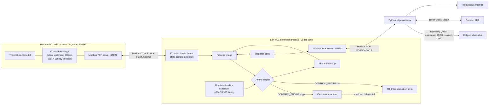

# Architecture and engineering decisions

## Context

A virtual cooling-water loop represents a small part of a scientific facility: pump, coolant flow, temperature sensor, controllable cooling actuator, and heat load. The plant is mathematical, **not connected to equipment**. Its purpose is testing interfaces and deterministic control semantics before commissioning hardware.

* **Two I/O modes.** `IO_MODE=local` keeps the plant inside the controller process (v0.1 baseline). `IO_MODE=remote` moves plant + I/O module into a separate `io_node` process, so the closed loop crosses a real process/network boundary (Docker: separate container on a field network the gateway cannot reach).
* **Two control engines, one contract.** `icl::ControlEngine::step(Inputs, dt) -> Outputs` is implemented by the C++ `Controller` and by `StController`, which executes the IEC 61131-3 block `st/FB_Interlocks.st` with the in-repo `stvm` interpreter. The non-selected engine runs in shadow on the same inputs every scan; disagreements are counted in input register 26.
* **Portable transport.** `lib/net` hides POSIX sockets vs Winsock2; the same sources build with PlatformIO `native` on Linux/WSL and on Windows (MinGW-w64).
* **Distribution:** Modbus TCP controller ↔ remote I/O and controller ↔ gateway; MQTT gateway → broker; REST gateway ↔ browser.
* **Not claimed:** certified PLC runtime, IEC conformance of stvm, hard real-time, physical safety.

## Scan cycle (one 50 ms period)

1. `sleep_until_precise(deadline)` — absolute deadline: `clock_nanosleep(CLOCK_MONOTONIC, TIMER_ABSTIME)` on Linux, high-resolution waitable timer on Windows.
2. **Input scan:** command FIFO, heartbeat age, latest field sample (`IoChannel::read`). Remote samples older than `IO_TIMEOUT_MS` are stale → `io_healthy=false`, `sensor_valid=false`.
3. **Logic:** primary engine + shadow engine.
4. **Output scan:** pump, cooling, heat load and fault injections to `IoChannel::write` (remote: picked up by the I/O thread, which also toggles the output watchdog register).
5. **Diagnostics:** lateness and execution time into 1200-sample windows (60 s); percentiles refreshed once per second; input registers published.

The remote I/O exchange runs in its own thread with socket timeouts, so a dead or slow network can only make data stale — it can never stall the scan (NFR-011).

## Fault handling across the distributed boundary

| Failure | Detected by | Reaction |
|---|---|---|
| I/O node crash / link down | I/O thread transaction error | sample stale → latched `IO_COMM_LOSS`, pump off, START/RESET blocked |
| Stuck transmitter (link up, data frozen) | `SAMPLE_SEQ` unchanged > 300 ms | same as above |
| Network latency 60 ms/response | — | tolerated (sample age stays inside budget) |
| Network latency 500 ms/response | client timeout | `IO_COMM_LOSS` |
| Controller crash | I/O node output watchdog (500 ms) | node forces outputs OFF (`FAILSAFE_ACTIVE`) |
| Gateway/HMI loss | heartbeat age > 3 s | latched `WATCHDOG` |
| ST runtime error (e.g. division by zero) | `StController` | latched FAULT, outputs de-energized permanently |

## Control theory / process model

`dT/dt = 0.075 × heat_load_fraction - 0.16 × cooling_fraction × flow_fraction + 0.012 × (ambient - T)`

All coefficients are **synthetic demonstration values**, not calibrated thermal-system parameters. `ambient = 26°C`, default `heat_load = 60%`, starting `T = 28°C`, default `T_set = 27°C`, flow when healthy = 12 L/min. The remote node integrates the same model at 100 Hz.

PI control uses `Kp = 16`, `Ki = 0.7`, direct cooling action (`error = measured - target`), 0–100% duty and conditional anti-windup (`PiCooling`, shared by both engines). Gains are illustrative, not a tuning recommendation.

## ADRs (architecture decision records)

| ID | Decision | Why | Trade-off |
|---|---|---|---|
| ADR-001 | PlatformIO Native, Linux-first (superseded in part by ADR-007) | Software-only reproducible C++17 development | Needs a host GCC |
| ADR-002 | Modbus TCP register interface | Widely recognizable industrial integration boundary | Minimal in-repo implementation for education; use audited libraries in production |
| ADR-003 | Python supervision gateway | Fast HTTP/MQTT integration; language boundaries explicit | Python is not part of the deterministic loop |
| ADR-004 | Simulated plant collocated with control (baseline) | Zero hardware, reproducible fault injection | Superseded as default for distributed demos by ADR-008 |
| ADR-005 | ST block kept as portable IEC source | Same file usable in OpenPLC / matiec later | Needs a runtime to execute (ADR-009) |
| ADR-006 | Local Docker bridge and ports | Repeatable deployment | No authentication/TLS; never publish these ports |
| ADR-007 | Thin socket portability layer (`lib/net`) | Run in the Windows IDE the team actually uses, plus Linux/WSL/CI | Windows timers need explicit handling (ADR-011) |
| ADR-008 | Remote I/O node as a separate process over Modbus TCP, scanned by a dedicated thread | Real distributed I/O semantics: stale data, link loss, output watchdog, latency | Plant model now duplicated in time (100 Hz vs 20 Hz) — acceptable for a virtual skid |
| ADR-009 | In-repo ST subset interpreter (stvm) instead of a PLC runtime dependency | Executes the real `.st` file in the scan and enables step-by-step differential testing against C++ in CI | Not IEC-conformant; no TON/CTU, loops, arrays. OpenPLC/matiec remains roadmap |
| ADR-010 | Shadow engine every scan | Continuous evidence that ST and C++ semantics agree in production-like conditions | ~2× logic cost (tens of µs) |
| ADR-011 | Absolute-deadline sleep with OS high-resolution timers | Measured: Windows `sleep_until` p50 lateness ≈ 8 ms → 0.3 ms after the change | Still soft real-time; no PREEMPT_RT, CPU isolation or IRQ affinity |

## Planned industrialization boundary

The proper transition to industrial equipment requires a vendor/PLC runtime or documented native runtime, an **externally independent** safety chain, secure communication, certified I/O where applicable, failure-mode analysis, a qualified real-time operating environment, hardware calibration, and supervised commissioning. Do not wire this PoC into a real refrigeration plant.
